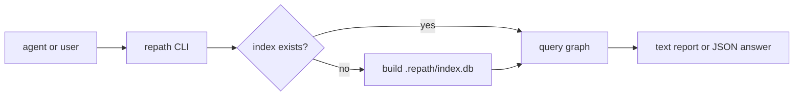
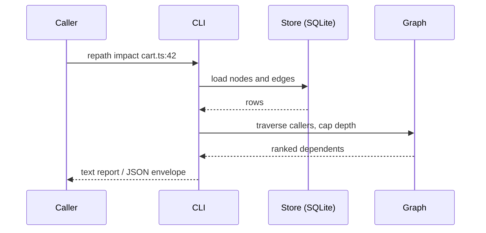

# Why

<!-- The problem, in one or two sentences, in behaviour-facing terms. -->

# What changed

-

<!-- Call out anything intentionally left unchanged, and name the commits. -->

# Visuals

<!-- Keep whichever diagram explains this change; delete the rest. Replace the placeholders. -->

<!-- Schema or migration change? Add an ER diagram. Lifecycle change? Add a stateDiagram-v2. Layout change? A before/after tree works too. -->

# Validation and proof

| Check | Command | Result |
| --- | --- | --- |
| format | `gofmt -l .` | |
| vet | `go vet ./...` | |
| tests | `go test ./...` | |
| build | `make build` | |
| manual | `./bin/repath status --json` | |

<!-- Name the evidence: test names, counts, command output. Say plainly what was NOT verified. -->

# CLI proof

<!-- Terminal output showing the visible result. Delete this section when the change has no observable surface. -->

| Before | After |
| --- | --- |
|  |  |

# Risk and rollback

-

---

- [ ] `make check` passes
- [ ] the new behaviour is covered by a test, or the PR says why not
- [ ] the new check fails without this change
- [ ] no new dependency, or the reason is stated above
- [ ] README or `PLAN.md` updated when behaviour or a locked decision changed
- [ ] exit codes unchanged, or documented in the PR
