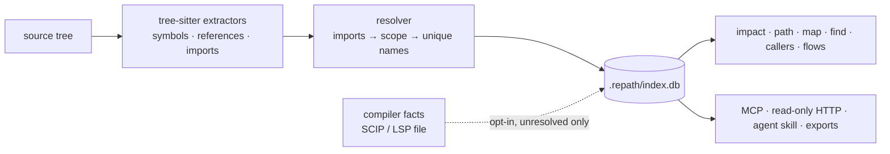

# repath

[](https://github.com/Goutam-11/repath/actions/workflows/ci.yml)
[](https://github.com/Goutam-11/repath/releases)
[](LICENSE)
[](go.mod)
[](#install)

**Structural answers about a codebase** — *what breaks if I change this*, *how
does A reach B*, *where is the important code* — from one deterministic,
confidence-tagged symbol graph. Built for humans and for coding agents: a CLI, a
stdio MCP server, a read-only HTTP surface, and an embedded agent skill, all over
a single SQLite file. No LLM, no daemon, no network calls for indexing or answers, and no
configuration file.

Every edge carries the rule that produced it and a confidence score, so an
answer can be audited instead of trusted. Anything the resolver cannot prove
stays visible as *unresolved* rather than being guessed.

```console
$ repath impact star_helper
impact of star_helper  function  app/star_pkg/impl.py:1
  1 dependents · 1 files · 1 modules · min-confidence 0.50 · depth 8

depth 1
  use_star  app/star_use.py:4  0.80  calls
```

- **Latest release:** [v1.3.0](https://github.com/Goutam-11/repath/releases/tag/v1.3.0)
  (Linux amd64/arm64, SHA-256 checksums).
- **Status:** the first tagged release. TypeScript/JavaScript, Python, and Rust
  are indexed; Go is [planned](https://github.com/Goutam-11/repath/issues/80).
  The contract (schema v6, 24 locked decisions) lives in [`PLAN.md`](PLAN.md).

---

## Table of contents

- [Why repath](#why-repath)
- [Quick start](#quick-start)
- [What it answers](#what-it-answers)
- [Features](#features)
- [How it works](#how-it-works)
- [Accuracy and performance](#accuracy-and-performance)
- [Documentation](#documentation)
- [CLI reference](#cli-reference)
- [Exit codes](#exit-codes)
- [Limitations and non-goals](#limitations-and-non-goals)
- [Contributing](#contributing)
- [Versioning and releases](#versioning-and-releases)
- [License](#license)

## Why repath

- **Pre-traversed answers, not file reads.** The graph is computed once; a
  question returns ranked, bounded output. Measured on three pinned corpora, an
  answer costs **33× fewer tokens** than reading the files it names
  ([method and caveats](docs/benchmarks.md#answer-tokens-vs-reading-the-files-2026-11-20-87)).
- **Confidence is data.** Every edge is `(rule id, confidence)`; agents and CI
  can filter with `--min-confidence`, and `status` reports the ambiguous and
  unresolved rates. The resolver never guesses a target to make a number look
  better.
- **Deterministic and local.** One SQLite file at `.repath/index.db`. No LLM, no
  embeddings, no daemon, no service. Incremental runs are git-aware; parallel
  git worktrees warm from a shared immutable cache.
- **Native to agents.** `repath mcp` speaks both the legacy stdio handshake and
  the 2026-07-28 discovery era; `repath install --all` copies the embedded skill
  into Claude Code, Codex, Cursor, Gemini CLI, and GitHub Copilot skill
  directories. `repath serve` is an optional read-only HTTP surface for
  shell-less clients.
- **Evidence, not claims.** Real-repo measurements, fixture gates, and
  compiler-scored accuracy are opt-in and reproducible
  ([`docs/benchmarks.md`](docs/benchmarks.md)).

## Quick start

### Install

Prebuilt archives and checksums are attached to the
[v1.3.0 release](https://github.com/Goutam-11/repath/releases/tag/v1.3.0):

```sh
version=1.3.0
arch=amd64          # or arm64
base="https://github.com/Goutam-11/repath/releases/download/v${version}"

curl -LO "${base}/repath_${version}_linux_${arch}.tar.gz"
curl -LO "${base}/checksums.txt"
sha256sum --check --ignore-missing checksums.txt
tar -xzf "repath_${version}_linux_${arch}.tar.gz"
sudo install -m 0755 repath /usr/local/bin/repath
repath --version    # v1.3.0
```

Or build from source — Go 1.27+ **and a C toolchain** (tree-sitter runs through
cgo; there is no pure-Go build):

```sh
git clone https://github.com/Goutam-11/repath
cd repath
make build && ./bin/repath --version
```

Cross-compilation and runtime notes are in [`docs/install.md`](docs/install.md).

### First answers

```sh
cd /path/to/repo
repath status --json                     # builds .repath/index.db on first use
repath impact <symbol>                   # transitive blast radius
repath path <from> <to>                  # shortest chain + alternates
repath map                               # ranked modules, cycles, hot symbols
repath find <symbol>                     # symbol card: callers, callees
```

Add `.repath/` to your own `.gitignore`. Everything is derived from the working
tree; nothing is written outside it.

### Use it from an agent

```sh
repath install --all        # copy the skill into every supported agent's skill dir
repath mcp                  # stdio JSON-RPC, six tools (for MCP clients)
repath serve --addr 127.0.0.1:0   # read-only HTTP, six answers
```

The skill (`skills/repath/SKILL.md`, ~300 tokens) teaches a shell-capable agent
the CLI. `uninstall` removes only the file we wrote; `--purge` is the explicit
way to delete `.repath/`. Paths per platform and transport details are in
[`docs/install.md`](docs/install.md#install-the-agent-skill) and
[`docs/mcp.md`](docs/mcp.md).

## What it answers

| Command | Question | Notes |
| --- | --- | --- |
| `impact <symbol\|file:line>` | What reaches this if I change it? | reverse closure, `--depth`, `--limit`, `--min-confidence` |
| `impact --diff [base]` | What breaks across a whole git change set? | union over changed files; skipped paths reported |
| `path <a> <b>` | How does A reach B? | shortest chain plus alternates |
| `find <symbol>` | What is this symbol? | location, kind, direct caller/callee counts |
| `callers <symbol>` | Who calls it directly? | one-hop reverse edges |
| `map` | Where is the important code? | PageRank, module rollup, cycles, token budget |
| `flows <entrypoint>` | What can this entrypoint reach? | Express/Fastify/Next.js, FastAPI/Flask, pytest, `main`, `#[test]` |
| `tests <symbol\|file:line>` | Which tests reach this change? | structural reachability, not coverage |

`tests --diff` and `impact --diff` take a git change set instead of one target.
All answers are available as text or `--json`, and the same six answers are
served over MCP and HTTP.

## Features

**Graph model.** Nodes are symbols only; files and modules are dimensions rolled
up at read time. Edges are `CALLS`, `REFERENCES`, `EXTENDS`, `IMPLEMENTS`, each
with a rule id and confidence. Unresolved references go to a `pending` queue
with a reason (`missing-definition`, `scope-gap`, `member-scope`,
`parse-failure`).

**Languages.** TypeScript/JavaScript (`.ts`, `.tsx`, `.js`, `.jsx`, `.mjs`,
`.cjs`), Python (`.py`), Rust (`.rs`). Import and module resolution, package
re-exports (including TypeScript barrels, `package.json` workspaces, and Python
star re-exports), inheritance/MRO, typed receivers, Rust module trees and
generic bounds. Grammar versions are pinned per language and differ on purpose.

**Compiler adapters, opt-in.** `repath adapter --scip` merges TypeScript/Python/Rust
compiler facts into unresolved references without overwriting tree-sitter edges;
`--lsp-facts` ingests the same kind of facts from an external LSP client. CI
never needs a compiler.

**Graph-native checks.** `repath check` reports cycles, dead code, boundary
crossings, hotspots, and the unresolved rate; `--fail-on` makes it a CI gate
with its own exit code `5`. `check --sarif` attaches an external tool's SARIF
2.1.0 findings to the enclosing symbols without running that tool.

**Committable exports.** `map --md` writes an `index.md` plus one page per module
(trimmed to a token budget, byte-identical across runs); `export --graphml|--dot`
writes the graph for Gephi, yEd, Obsidian, or Graphviz, with `--modules` for the
module-level view. Both are read-only projections — no new nodes or edges.

**Monorepos and CI.** `index --scope DIR` limits discovery to a subtree while
keeping the repo root for module detection and git invalidation (Kibana:
38,548 files / 23.3 s whole tree vs **2,939 / 2.34 s scoped**). `index
--artifact` exports a commit-keyed SQLite snapshot (opt-in zstd, ~25% of the
uncompressed size); `pull` seeds another machine or checkout.

**Runtime evidence, read-only.** `repath trace --file profile.cpuprofile` maps a
V8 CPU profile onto the static graph and reports observed calls — including
dynamic dispatch — without writing to the graph.

**Cross-language links, opt-in.** A literal-path HTTP client call can be linked
to its FastAPI/Flask/Express handler at confidence `0.45`; default answers
exclude those links, `--min-confidence 0.4` opts in.

## How it works



The indexer parses changed files, persists symbols and import bindings, then the
resolver links references using a documented confidence ladder: explicit imports
first, then local scope and module receivers, then inheritance/typed receivers,
then unique global names, then ambiguity. A target that cannot be proven stays
unresolved; 2–5 candidates become a visible `0.40` group; more than five are
dropped. Compiler facts may fill unresolved references but never overwrite a
resolved edge.

Cold, incremental, and second `--full` runs produce identical edge and pending
row sets (the parity guarantee behind `#49`), and node ids are stable across
re-indexing. The full contract is [`PLAN.md`](PLAN.md); the ladder and its gaps
are [`docs/resolution.md`](docs/resolution.md).

## Accuracy and performance

Numbers below are measured, reproducible with the commands in
[`docs/benchmarks.md`](docs/benchmarks.md), and quoted with their workload
(pinned commit, file count) rather than as a single headline. Timings move with
host load; graph structure does not.

| Tree | Files | Cold index | Edges / unresolved | Peak RSS |
| --- | --- | --- | --- | --- |
| `psf/requests` @ `3c7baaa` | 37 | ~0.1 s | 1,044 / 510 | 33 MiB |
| `django/django` @ `f24f38c` | 3,051 | 4.3 s | 63,537 / 83,359 | 263 MiB |
| Kibana subtree (`--scope`) @ `0551196` | 2,939 | 2.3 s | 3,592 / 9,461 | 120 MiB |
| `elastic/kibana` whole tree @ `0551196` | 38,548 | 23.3 s | 62,489 / 157,205 | 630 MiB |
| synthetic 50k-file tree | 50,000 | 10.1 s | 49,500 / — | 282 MiB |

- **Answer cost:** 33× fewer tokens than reading the files the answer names
  (48,112 vs 1,585,662 over 24 fixed questions on the three corpora).
- **Compiler-scored accuracy** (sampled against SCIP on requests/rayon/django):
  `callers` precision 95.9–99.2% and recall 32.3–65.5%; `impact` depth 2
  precision 90.1–99.2% and recall 38.9–44.5%. The gaps are documented per rule.
- **Budgets:** the synthetic 50k gate is <3 min / <1 GB / `impact` p95 <150 ms /
  `map` p95 <300 ms; measured **10.1 s / 282 MiB / 66 ms / 174 ms**. Measured
  and never a CI gate: `make perf`, `make bench-real`, `make bench-corpora`,
  `make bench-tokens`.

## Documentation

| Document | Contents |
| --- | --- |
| [`PLAN.md`](PLAN.md) | The specification: decisions, schema, CLI/MCP contracts, milestones, budgets |
| [`docs/install.md`](docs/install.md) | Release install, source build, cross-compilation, agent-skill paths |
| [`docs/resolution.md`](docs/resolution.md) | The confidence ladder, rules, and known resolver gaps |
| [`docs/scope.md`](docs/scope.md) | `index --scope` semantics, caching, artifacts |
| [`docs/export.md`](docs/export.md) | `map --md`, GraphML, and DOT contracts |
| [`docs/mcp.md`](docs/mcp.md) · [`docs/serve.md`](docs/serve.md) | Agent transports and their envelopes |
| [`docs/check.md`](docs/check.md) | Graph-native checks, severities, SARIF |
| [`docs/adapters.md`](docs/adapters.md) | SCIP and LSP-facts merge policy |
| [`docs/xlang.md`](docs/xlang.md) · [`docs/trace.md`](docs/trace.md) | Cross-language links, runtime evidence |
| [`docs/flows.md`](docs/flows.md) · [`docs/tests.md`](docs/tests.md) | Entrypoints and test impact |
| [`docs/sharing.md`](docs/sharing.md) · [`docs/worktrees.md`](docs/worktrees.md) | Artifacts and worktree cache |
| [`docs/benchmarks.md`](docs/benchmarks.md) | Every measured number, producer versions, caveats |
| [`docs/development.md`](docs/development.md) | Branches, commits, PRs, definition of done |
| [`CONTRIBUTING.md`](CONTRIBUTING.md) | Setup, the contribution flow, and the rules that matter |

## CLI reference

```sh
# index and state
repath index [--full] [--json] [--artifact DIR] [--compress] [--scope DIR ...]
repath pull <path|url> [--json]
repath status [--json] [--no-refresh]

# answers
repath impact <symbol|file:line> [--depth 8] [--limit 50] [--min-confidence 0.5] [--json]
repath impact --diff [base]
repath path <from> <to> [--max-depth 8] [--json]
repath find <symbol> [--module M] [--json]
repath callers <symbol> [--min-confidence 0.5] [--json]
repath tests <symbol|file:line> [--diff [base]] [--json]
repath map [--max-tokens 2000] [--json] | repath map --md [--out DIR]
repath flows <entrypoint> [--depth 6] [--limit 20] [--json]

# projections and checks
repath export --graphml|--dot [--modules] [--out FILE] [--min-confidence 0.5]
repath check [--fail-on none|error|warning|info] [--max-findings N] [--sarif FILE|DIR ...] [--json]
repath trace --file PROFILE [--limit 50] [--json]

# integrations
repath adapter --scip FILE | --lsp-facts FILE [--json]
repath mcp [--root DIR]
repath serve [--addr 127.0.0.1:0] [--root DIR]
repath install [--platform claude|codex|cursor|gemini|vscode] [--all] [--force] [--json]
repath uninstall [--platform NAME|--all] [--purge] [--json]
repath version
```

Symbol references accept a qualified name, a bare name, `file:line`, or
`file:name`.

## Exit codes

| Code | Meaning |
| --- | --- |
| `0` | success |
| `1` | internal error |
| `2` | usage error |
| `3` | not found |
| `4` | ambiguous (candidates are printed / in `error.candidates`) |
| `5` | `check` findings at or above `--fail-on` (check-only; never reused) |

## Limitations and non-goals

- **No Go support yet** ([#80](https://github.com/Goutam-11/repath/issues/80),
  decision-gated). `pnpm-workspace.yaml` workspaces are not read
  ([#79](https://github.com/Goutam-11/repath/issues/79)); Kibana's `@kbn/*`
  imports therefore stay external.
- **cgo is required.** Release binaries are dynamically linked (glibc);
  arm64 cross-compiles need an aarch64 C toolchain.
- **Parser and resolver limits are documented, not hidden:** some valid
  TypeScript fails to parse (stored with `parse_ok=0` and counted); Python
  imports search the repo root, `src/`, and `lib/` only (no `sys.path`,
  namespace packages, or `__getattr__` re-exports); Rust macro bodies are blind
  and generic containers are not inferred.
- **One repository per index.** No merged cross-repo index yet
  ([#88](https://github.com/Goutam-11/repath/issues/88)); a scoped index is per
  worktree.
- **No UI, auth, config file, or seventh MCP tool.** `serve` is read-only and
  loopback by default; widening `--addr` is unauthenticated and warns.
- **No LLM and no embeddings**, by design. Answers are structural and
  confidence-tagged; semantics beyond the graph are out of scope.

## Contributing

Contributions are welcome. Start with [`CONTRIBUTING.md`](CONTRIBUTING.md) for
the short version and [`docs/development.md`](docs/development.md) for the full
workflow:

```sh
git clone https://github.com/Goutam-11/repath && cd repath
make hooks      # install the commit-identity guard (once per clone)
make check      # gofmt + vet + tests + hook tests — the PR gate
make perf       # when touching index/query paths (opt-in budgets)
```

- Branch `type/scope` from `main`, write conventional commits, open a PR; the
  template asks for a diagram, a real-number validation table, and an honest
  "not verified" line. `main` is protected: CI green, squash merge.
- One logical change per PR. A change that contradicts a locked decision in
  [`PLAN.md`](PLAN.md) §3 needs an amendment in the same PR and explicit
  approval; a new resolver rule needs a fixture case and a ladder row.
- No new dependency without a stated reason. Fixture gates
  (`testdata/fixtures/*/expected.json`) are never loosened to make a PR pass.
- The full workflow, including worktree-based parallel work, is in
  [`docs/development.md`](docs/development.md).

## Versioning and releases

Tags follow `vMAJOR.MINOR.PATCH`; `v1.3.0` is the first release. A tag
push triggers GoReleaser (Linux amd64/arm64 with cgo, `checksums.txt`, source
archive) and creates a **draft** release that a human publishes; `repath
--version` prints the tag. Release notes live in
[`docs/releases/`](docs/releases/). The schema is versioned separately
(currently v6) and old `.repath/` databases are rebuilt on mismatch.

## License

[MIT](LICENSE) © 2026 Goutam Kumar Sharma
